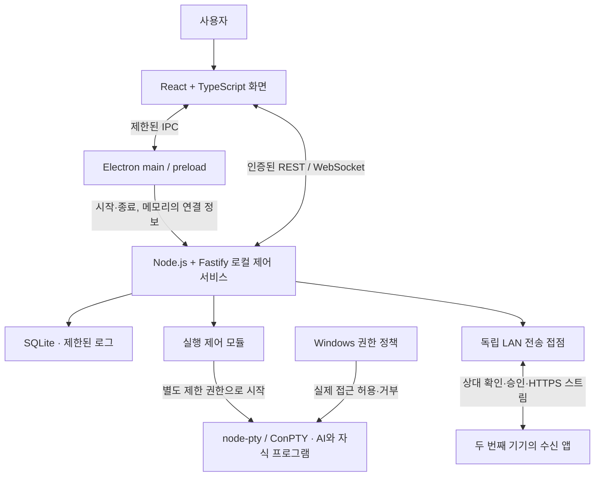

# 시스템 구조와 기술 실험

상태: 설계 기준안과 이번 구체화 제안. 기술 설치·호환성·보호 성공은 검증하지 않았다. 요구 ID는 [PROJECT_OVERVIEW](PROJECT_OVERVIEW.md), 실험과 구현 작업은 [TASKS](TASKS.md)를 따른다.

## 역할과 권한 경계

| 구성 | 책임·보유 데이터 | 허용하지 않는 책임 |
|---|---|---|
| React·xterm.js | 화면, 사용자 입력, 기능/파일 트리, 터미널 표시 | 직접 파일 권한 변경·임의 OS 실행·DB 접근 |
| Electron main·preload | 창·폴더 선택·외부 편집기 호출·서비스 관리, 필요한 좁은 IPC만 노출 | 범용 shell 실행 API, 임의 웹 콘텐츠의 Node 접근 |
| Fastify 로컬 서비스 | 프로젝트·기능·검증·세션·정책 계약과 저장, 실행 요청 조정 | LAN에 AI 실행 제어 공개, UI 문자열을 곧바로 명령으로 실행 |
| 실행 제어 모듈 | 도구별 실행·중단·상태·프로세스 소유 확인, 보호 실행 권한 적용 | 정책 실패를 일반 권한 실행으로 자동 전환 |
| 제한 실행부·PTY | 실제 CLI 입출력, 제한된 작업 경로 | UI/서비스 인증정보와 정책 저장소 접근 |
| SQLite·로그 | 구조화 데이터·감사 가능한 사건·제한된 출력 | 인증 토큰·비밀번호·로그인 URL 저장 |
| LAN 전송 접점 | 연결 확인·전송 승인·스트림·해시·정리 | 원격 AI 실행·임의 경로 읽기·프로젝트 동기화 |

Electron은 화면과 권한 있는 프로세스를 분리해야 한다. renderer는 `nodeIntegration: false`, `contextIsolation: true`, sandbox 사용을 기준으로 하며 IPC 발신자·인자를 검사한다. 정확한 지원 조합은 T-002에서 확인한다. [Electron 보안 지침](https://www.electronjs.org/docs/latest/tutorial/security)

node-pty는 부모와 같은 권한으로 프로그램을 실행한다. 따라서 일반 Node 서비스에서 PTY를 만들었다는 사실은 보호가 아니다. 보호 모드에서는 **제한된 실행 주체가 PTY·AI·자식을 생성하도록 하는 별도 경계**가 필요하다. 이 연결은 X-002의 핵심 검증이며, 필요하면 작은 Windows 실행 도우미를 제안하되 구현 언어·추가 빌드 공수는 실험 뒤 결정한다. [node-pty](https://github.com/microsoft/node-pty)

## 시작·중단·종료·재시작

1. Electron이 중복 실행 여부와 사용자 데이터 위치를 확인한다. 루프백의 임의 사용 가능 포트에 로컬 서비스를 시작하고, 인증 비밀은 프로세스 메모리·제한된 IPC로만 전달한다.
2. 서비스는 DB 버전을 확인한다. 변경 전 일관된 백업을 만들고 마이그레이션(기존 데이터를 새 구조로 바꾸는 작업)을 수행한다. 실패 시 기존 DB를 보존하고 쓰기 기능을 중지한다.
3. readiness(준비 완료) 신호 후 화면이 초기 데이터를 받고 이벤트를 구독한다. 실행 준비 실패는 화면에 오류와 재시도 조건으로 표시한다.
4. 세션 시작은 도구 경로·인자 배열·작업 폴더·기능 버전·보호 정책 버전을 고정한다. 보호 실행 요청은 적용 확인 실패 시 종료한다.
5. 세션 상태는 `starting → running → stopping → exited/error/interrupted`를 기본으로 한다. 명시적인 도구 이벤트가 있을 때만 입력/승인 대기를 추가한다. 무출력은 생각 중의 증거가 아니다.
6. 중단은 협력 종료 신호 → 제한 시간 대기 → 앱이 소유한 프로세스 묶음만 종료 순서다. PID만 믿지 않고 시작 시각·실행 식별자·소유 관계를 확인한다. Windows Job Object(자식들을 함께 관리하는 OS 기능)는 정리 후보이며 파일 격리 수단이 아니다.
7. 사용자 앱 종료 시 활성 세션과 중단 결과를 안내하고 PTY·자식·소켓·타이머·파일 핸들·로그·DB를 정리한다. 종료 실패를 기록한다.
8. 재시작은 **저장된 이력 복원**이다. 예전 PID를 자동 재연결하거나 AI 작업을 자동 재실행하지 않는다. 도구의 대화 재개 기능은 지원 확인 후 사용자 선택으로 수행한다.
9. 서비스 충돌 시 UI를 연결 끊김 상태로 바꾸고 지수형 재시도 횟수에 한도를 둔다. 살아남은 자식이 있으면 고아 프로세스(관리 부모가 없는 프로세스)로 표시하고 안전하게 소유를 확인하여 정리한다.

R-06·R-13의 증거는 종료 코드뿐 아니라 잔존 프로세스·포트·복원된 데이터·사용자 흐름으로 남긴다.

## API와 실시간 계약 — 제안, 아직 존재하는 API 아님

REST는 조회·변경 요청과 응답, WebSocket은 연결을 유지하는 실시간 통신, IPC는 Electron 내부 프로세스 사이의 제한된 통신이다.

| 접점 예시 | 내용 | 검사·실패 |
|---|---|---|
| GET/POST `/v1/projects` | 프로젝트 목록·생성 | 이름 길이·폴더 존재·접근 가능·중복 |
| GET/PATCH `/v1/projects/:id/features/:fid` | 기능 조회·편집 | project 소속·버전·선행 순환·완료 조건 |
| POST `/v1/projects/:id/analysis` | 대화·기능 생성 요청 | 요청 크기·사용 도구·사용자 동의·취소 |
| POST `/v1/features/:id/verifications` | 실제 검증 결과·근거 저장 | 조건 버전·결과·증거 존재, 완료 판정과 분리 |
| POST `/v1/sessions`, `/:id/stop` | 실행·중단 | 사용자 요청·경로·정책 버전·도구 허용 목록 |
| GET/PUT `/v1/protection-policies/:id` | 정책·적용 상태 | 정책 변경은 신뢰된 UI의 명시 동작만 허용 |
| `/v1/events` WebSocket | 세션·기능·보호·전송 사건 | 세션 인증·구독 범위·크기·빈도 상한 |
| LAN `/v1/pairing`, `/v1/transfers` | 상대 확인·승인·본문·결과 | 전송 전용 인증, 로컬 실행 API와 별도 포트·라우터 |

공통 요청은 `requestId`, 변경 대상 버전, 필요 시 중복 요청 키를 가진다. 재시도한 생성·전송이 중복 실행되지 않도록 결과를 연결한다. 오류는 `code / 사용자용 message / retryable / requestId`로 전달한다. 내부 경로·스택·비밀은 사용자 응답에 무분별하게 포함하지 않는다. 형식 오류 400, 인증 실패 401/403, 버전 충돌 409, 크기 초과 413 등의 사용은 T-004에서 확정한다.

WebSocket 사건의 제안 필드는 `eventId, sequence, occurredAt(UTC), projectId, featureId?, sessionId?, type, source, payload, schemaVersion`이다. 화면은 KST로 표시한다. 출력 청크·입력·크기 변경과 영구 활동 사건은 구분한다. 연결 복구 시 마지막 sequence 이후 사건을 받거나 최신 상태를 다시 조회하고, 놓친 출력은 명시한다. 무한 재전송·무한 버퍼를 두지 않는다.

인증되지 않은 WebSocket 연결과 출처가 다른 브라우저 연결은 거부한다. 브라우저 WebSocket 제약상 헤더가 어려우면 제한된 IPC를 통한 연결 중계 또는 짧은 일회성 연결 표를 검토한다. 장기 비밀을 URL·로그·프로젝트 파일에 넣지 않는다. 어느 방식을 쓸지는 T-004에서 시험한다.

입력의 모양은 JSON Schema 같은 공통 규칙으로 서버에서 검사하고, 화면 검사는 사용 편의를 위한 추가 검사로 둔다. 사용자/AI가 만든 스키마를 서버 코드처럼 실행하지 않는다. [Fastify 입력 검증](https://fastify.dev/docs/latest/Reference/Validation-and-Serialization/)

## 공통 데이터 — 최소 구조 제안

| 구조 | 중요한 필드·불변 조건 |
|---|---|
| Project | id, name, rootPath, createdAt, updatedAt, version |
| Requirement/AnalysisTurn | projectId, role, text, source, revision. 비밀 제거·보관 정책 적용 |
| Feature | id, parentId, name, description, acceptanceCriteria, state, revision, relatedPaths |
| FeatureDependency | featureId, prerequisiteId. 자기 참조·순환·다른 프로젝트 연결 금지 |
| Verification | featureId, featureRevision, method, expected, actual, result, evidenceRef, actor, checkedAt |
| Session | id, featureId, featureRevision, adapter, cwd, state, toolSessionRef, policyRevision, start/end. 계정 비밀 제외 |
| ProtectionPolicy/AppliedPolicy | 지정 경로·동작·대상 실행 주체·revision / 적용 결과·환경·한계·시각을 별도로 저장 |
| ActivityEvent | 출처·시각·대상 ID·유형·결과·근거. 파일 변경 감지를 AI 읽기 기록으로 변환하지 않음 |
| Transfer | peerId, displayName, approvedDestination, size, digest, state, tempRef, result |
| SchemaVersion | 적용한 DB 변환 버전·시각·결과 |

완료 기능의 요구·조건을 수정하면 이전 검증은 과거 버전에 남고 현재 상태는 검증 대기로 돌아간다. 진행률의 분모는 삭제되지 않은 말단 기능만 집계한다. 세션 상태, 기능 상태, 보호 적용 상태, 전송 상태를 하나의 완료 값에 섞지 않는다.

## 인증·권한·파일 경계

- 로컬 제어부는 `127.0.0.1`/필요한 루프백에만 바인딩한다. 루프백이라는 이유만으로 신뢰하지 않고 임시 인증·Origin/Host·IPC 발신자를 확인한다.
- AI에 로컬 API 인증 비밀·정책 DB·실행 도우미 제어 권한을 전달하지 않는다. 제한 AI가 privileged 서비스에 대신 파일을 읽게 하는 우회 요청도 시험한다.
- 외부 편집기 실행은 관측·허용된 실행 파일과 인자 배열을 사용한다. 사용자 입력을 shell 문자열에 붙이지 않는다. 입력된 경로는 프로젝트/선택 범위·정규화·실제 대상 확인을 거친다.
- AI 출력·파일명·대화는 신뢰할 수 없는 데이터다. HTML 실행과 임의 외부 URL 열기를 제한하며 터미널 escape/link 기능도 검토한다. [xterm.js 보안](https://xtermjs.org/docs/guides/security/)
- OS 보호 위협 모델: 제한 AI와 그 자식의 실수·금지 경로 시도, 정책 변경 시도까지 대상으로 한다. 관리자/커널 권한 공격·사용자가 보호 내용을 직접 프롬프트에 입력한 경우까지 막는다고 주장하지 않는다.
- 별도 제한 계정 + ACL(파일별 허용 권한 목록)과 AppContainer(OS 격리 실행 환경)를 비교한다. 소유권·ACL 변경 권한·부모 폴더 삭제 권한·상속을 포함해 시험한다. 일반 사용자 전체에 deny를 걸어 사용자까지 막는 방식은 채택하지 않는다.
- 이미 열린 핸들·링크·별칭·재분석 지점·경로 검사 후 대상 교체는 방식별 한계가 있다. 실험에서 재현하고, 보장 못 하는 입력은 보호 모드에서 거부하거나 미지원으로 표시한다. 전체 경로 우회가 해결됐다고 미리 쓰지 않는다.
- 모든 파일 읽기 감사를 보장하지 않는다. OS 접근 거부 증거와 사건을 앱으로 가져오는 수단은 별도로 확인한다. 없는 감사 기능을 파일 감시나 터미널 문장으로 대체하지 않는다.

## LAN 전송 — 보안 구체화 제안

주소 입력으로 상대를 찾고 양쪽 화면에서 상대 정보·인증서 지문(인증서를 구별하는 값)을 확인한다. 일회성 코드는 짧은 만료·시도 횟수 제한·재사용 거부를 적용한다. 숫자 코드 하나나 인증서 검사 해제만으로 안전한 상대 확인이 됐다고 가정하지 않는다. 자체 인증서 신뢰 방법은 X-003에서 선택한다.

수신자가 이름·크기·저장 위치를 보고 승인한 뒤 본문을 받는다. 입력 파일명에서 경로·드라이브·상위 이동·예약 이름·대체 데이터 스트림을 거부하고 수신 루트 아래 실제 경로를 확인한다. 같은 볼륨의 임시 파일로 저장 → 크기·SHA-256 확인 → 기존 파일을 덮어쓰지 않는 원자적 확정 순서로 처리한다. 임시 파일을 곧바로 성공 파일로 보여주지 않는다.

거절·취소·연결 종료·용량 부족·권한 오류·해시 불일치는 각 결과로 남기고 부분 파일 정리/사용자 재시도 방법을 제공한다. 전송 중 송신 파일이 바뀌면 불일치·실패 처리한다. 보호 파일은 권한 있는 전송 서비스가 AI의 요청으로 대신 유출하지 못하도록 사용자 선택과 정책 경계를 검증한다. 원격 기기에 AI 실행·정책 해제 권한은 없다.

## 저장·백업·복구·배포

DB와 로그는 저장소·OneDrive 동기화 폴더 밖의 앱 사용자 데이터 위치에 둔다. 실제 프로젝트 소스 파일은 사용자가 고른 폴더에 유지한다. SQLite 접근은 서비스가 모으고 명시적 트랜잭션(여러 변경을 함께 성공/취소하는 단위)을 사용한다. 외래키·인덱스·잠금 시간 한도·손상 오류를 시험한다.

DB 드라이버와 WAL 사용 여부는 T-005에서 결정한다. WAL은 추가 기록 파일이 DB 상태의 일부이므로 실행 중 DB 본파일만 복사하지 않는다. 지원되는 백업 API 또는 앱 쓰기 중지·DB 종료 후 일관된 사본을 사용한다. [SQLite 백업](https://www.sqlite.org/backup.html), [WAL](https://www.sqlite.org/wal.html)

스키마 버전을 순서대로 올리고 변환 전 백업·실패 시 기존 파일 보존·이전 앱과의 호환 여부를 기록한다. 복구는 별도 사본에서 무결성 검사와 프로젝트/기능 수·검증 관계·이력 재현 후 적용한다. 백업에는 앱 DB·설정·필요한 프로젝트 파일 목록을 구분하며 AI 로그인 정보는 일반 백업에 섞지 않는다. 복원된 정책은 실제 OS에 재확인하기 전 활성으로 표시하지 않는다.

배포는 T-101에서 지원 Windows/CPU·필요 권한·AI CLI 별도 설치 요건을 확정한다. 프로토타입은 재현 가능한 실행물과 안내, 최종은 설치·업데이트·제거·데이터 보존 검증을 목표로 한다. 우선 수동 업데이트+백업 복구를 제안하며 자동 업데이트와 코드 서명 비용은 예산 확인 후 선택한다. 보안 설정을 설치 때 무조건 바꾸지 않고 필요한 동작·복원 방법을 안내한다.

## 주요 구조 결정

| 결정 | 이유·대안 | 아직 검증할 한계·일정 영향 |
|---|---|---|
| A-01 Electron·React·TypeScript 유지 | 로컬 창·Node 터미널·단일 언어 연계. Tauri/네이티브 앱은 대안 | 네이티브 모듈·패키징 호환 T-002·X-001. 변경 필요 시 UI/실행부 재작업 추정 후 결정 |
| A-02 Fastify·REST+WebSocket | 데이터 계약과 실시간 입출력 분리. IPC 전용 서비스가 단순화 대안 | 작은 앱의 추가 프로세스·인증 부담. 먼저 최소 계약만 만들고 서비스 수를 늘리지 않음 |
| A-03 SQLite·제한 로그 | 단일 사용자 로컬 데이터. MongoDB·중앙 서버는 현재 필요 없음 | 드라이버·마이그레이션·WAL 조합 검증 T-005·T-102 |
| A-04 PTY+도구별 adapter | 상호작용 터미널과 도구 차이 분리 | 구조화 이벤트/응답은 공식 지원 방식 우선. 텍스트 추측 파싱은 상태·완료 근거로 쓰지 않음 |
| A-05 별도 OS 집행 경계 | UI 격리·프로세스 종료로 R-09 충족 불가 | ACL/제한 계정과 AppContainer 실험 후 선택. 실행 도우미 추가 공수는 현재 범위에 보장하지 않음 |
| A-06 전송 접점 분리 | LAN 사용자가 로컬 AI 제어에 접근하지 못하게 함 | 인증서 신뢰·방화벽·두 실제 기기 필요. 실패 시 X-003 결과로 재계획 |
| A-07 개발 운영용 자동 보조 호출 | 모델·위험 분류와 검토 요청/결과 회수를 주담당이 관리. 수동 대화 복사 대안이며 앱 기능 요구 추가가 아님 | [X-001](experiments/X-001.md)의 제한된 읽기 전용 실행기. 실제 CLI 모델/응답 미검증, 현재 대화 모델과 별개. 위험 수용·핵심 범위 결정은 사용자 |

### A-08 UI 프로토타입의 단계적 구현 — 2026-10-04

T-002에서 Electron·React·TypeScript 실행 틀과 후속 기능 화면을 먼저 구현한다. 상태는 현재 실행의 메모리에만 두며 Fastify·SQLite·PTY·OS 보호·전송은 후속 작업이다. 전체 기획을 메모리 기반 앱으로 바꾸는 결정이 아니다. 처음부터 서비스·DB까지 동시에 통합하는 대안보다 사용자가 요청한 화면 흐름을 먼저 검토할 수 있다. 후속 저장·서비스 연결 때 상태 모델과 검증 이력을 이관해야 하는 비용이 남는다.

정적 빌드는 `orbit://app/`의 허용된 자원만 제공하고, 개발 화면은 고정된 루프백 주소를 사용한다. 격리된 renderer에 폴더 선택 한 가지 통신만 노출한다. 주 프로세스가 발신 창·주 프레임·출처·인자를 확인한다. Node 접근·임의 탐색·새 창·권한 요청을 제한한다. 이것은 AI 프로세스의 파일 접근을 통제하는 A-05와 별개다. 검증과 미실행 범위는 [UI 안내](UI_PROTOTYPE.md)·WL-20261004-03을 따른다. 원래 일정·작업 완료 기준은 유지하며 전체 공수 단축을 확정하지 않는다.

### A-09 T-003 실제 Codex 연결 — 2026-10-04

WL-20261004-05에서 X-001의 native Codex exec 후보를 실제 앱에 연결했다. React/xterm → 고정 preload 통신 → main SessionManager → 전용 Electron Node 호스트 → PTY/native Codex 구조다. main이 네이티브로 선택한 프로젝트 ID·경로와 대화 ID를 소유한다. 화면은 명령·실행 파일·환경·재개 ID를 전달하지 않는다. 초기 연결은 읽기 전용 Codex 단일 실행이며 TUI·Gemini·역할 분담·Fastify·DB를 함께 완료한 것이 아니다.

실행 상태는 호스트 사건으로 표시하고 기능 완료와 분리한다. CLI가 출력한 첫 헤더만 요청 모델·읽기 전용 설정·대화 ID 대조에 사용하며 본문의 상태처럼 보이는 문자열은 판정에 사용하지 않는다. 512 KiB 보관·64 KiB 조회·출력 세대/순번·호스트 ACK·실행당 8 MiB/10분 한도, 준비 조회 종료 대기/상한과 중복 방지를 둔다. 종료는 Ctrl+C→소유 PTY 종료→소유 호스트 종료→관측 프로세스 정리 확인이며 정리 미확인은 다음 실행을 차단한다. 이름 기반 일괄 종료는 하지 않는다.

node-pty 1.1.0 자연 종료 문제 때문에 이 프로토타입은 전용 호스트와 명시적 번들 ConPTY DLL을 사용한다. 실제 앱의 응답·재개·중단·종료를 확인했지만 OS 격리·모든 PC·패키징 검증으로 확대하지 않는다. xterm 동적 CSS를 위해 스타일 요소에 한해 inline을 허용하고 스크립트/Node/출처 경계는 유지한다. [AI 연결 안내](AI_CONNECTION.md)에 근거와 제한을 둔다. A-08은 이전 UI 단계의 이력으로 보존한다.

## 위험 기술 실험 — 계획과 실제 상태 구분

아래는 기준 실험 계획이다. X-001은 사용자의 후속 지시로 착수했으며 [별도 보고](experiments/X-001.md)에 실제 결과를 기록한다. X-002/X-003은 설계 단계다.

| 작업 | 목적·환경·가짜 데이터 | 시간 한도 제안 | 성공·실패 판정과 다음 선택 |
|---|---|---|---|
| X-001 | 실제 계정·설치된 CLI 버전·Windows 빌드 기록. 임시 샘플 프로젝트에서 로그인·대화·PTY·한글·크기·중단·세션 재개·구조화 출력 경로 확인 | 4~8h, 8h에 판단 중단 | AI 응답 1회, 입출력·중단·자원 정리, 지원 이벤트/응답 방식·별도 API 비용 여부를 증거로 남김. 실패면 단독 CLI/PTY/앱 단계 분리, 공식 대체 연결 비교·예산 질의. 로그인 비밀 저장 금지 |
| X-002 | 복구 가능한 VM 또는 전용 계정·가짜 보호 파일/허용 파일. 현재 사용자와 제한 AI 및 자식 프로그램을 분리. 별도 계정+ACL 우선 비교, AppContainer 대안 | 8~16h, 8h 중간 판단·16h 한도 | 아래 행렬 전부와 실제 AI 호환 결과 필요. 하나라도 우회 성공이면 성공 범위를 좁혀 기록하고 R-09 미충족. 한도 초과면 실패/미결로 종료, 대안 비용·추가 시간·프로토타입 범위 조정을 사용자에게 제시. 일반 실행으로 우회 금지 |
| X-003 | 실제 두 Windows 기기·동일 LAN·테스트 수신 폴더. 0B/1MiB/100MiB 가짜 파일·중복 이름·잘못된 경로 | 4~8h, 8h 한도 | 상대 확인·승인·해시 일치·거절·끊김·경로/덮어쓰기 방어 재현. 실패면 인증/네트워크/파일 문제 분리, 수동 주소 유지, 두 기기 확보 전 로컬 시험은 부분 증거로만 인정 |

사용자는 친구 PC 실험 가능과 블루스크린 주의를 알려주었고 권장 안전 실험 방향을 수용했다. 친구 PC의 Windows/CPU·동일 LAN·실험 일정·복구 환경은 아직 미확인이다. OS 실험은 사용자에게 확인된 환경에서 **후속 개발 요청으로 실행**한다. 현재 컴퓨터의 ACL·계정·방화벽·보안 정책은 이번에 바꾸지 않는다. 보안 완화를 호환성 해결로 사용하지 않는다.

| X-002 검증 행렬 | 기대 결과·증거 |
|---|---|
| 일반 사용자 편집기 → 보호/허용 파일 | 정상 읽기·편집, 실제 변경 결과 |
| 제한 AI 직접 → 보호 파일 읽기·수정·삭제 | OS 접근 거부, 내용 비공개·해시/존재 불변, 오류 코드 |
| 제한 AI가 띄운 PowerShell/별도 프로그램 → 동일 동작 | 같은 거부, 자식 실행 신원·시작 조건 기록 |
| 제한 AI → 허용 파일·샘플 개발 명령 | 정상 읽기·변경·결과 생성 |
| 정책/ACL 변경 시도·로컬 서비스 우회 요청 | 제한 주체가 보호를 해제하거나 대신 읽게 하지 못함 |
| 사전 열린 파일·링크/별칭·경로 변경·부모 폴더 삭제 | 실제 결과와 지원 한계 개별 기록, 미검증을 통과로 표시하지 않음 |
| 정책 적용 실패·앱 재시작·중단 후 복원 | 보호 실행 거부·상태 정정·실험 전 접근권 복구 확인 |
| OS 감사 수집 | 실제 얻은 시각/경로/동작/주체만 표시, 거부 성공과 수집 성공 별도 판정 |

실험 결과 양식: 환경·버전·수행 주체·데이터·명령/방법·기대·실제·증거 위치·통과/실패/미실행·재현 한계·다음 선택. 원문 터미널 전체 대신 비밀을 뺀 필요한 근거만 기록한다.

## 확인한 공식 자료

조회일: 모두 2026-10-03 KST. 아래에서 ‘미표시’는 이번 조회 응답에서 문서 최종 수정일을 확인하지 못했다는 뜻이다. 최신 문서의 일반 설명은 이 프로젝트 호환성 시험을 대체하지 않는다.

| 제목·링크 | 확인 가능한 최종 수정일 | 이번 사용 범위 |
|---|---|---|
| [Electron Security](https://www.electronjs.org/docs/latest/tutorial/security) | 미표시 | renderer·IPC·신뢰 경계 |
| [microsoft/node-pty](https://github.com/microsoft/node-pty) | README 최종 수정일 미확인 | ConPTY·부모 권한·네이티브 빌드 위험. 선택 버전은 미정 |
| [Fastify Validation and Serialization](https://fastify.dev/docs/latest/Reference/Validation-and-Serialization/) | 미표시 | 서버 입력/응답 계약 |
| [xterm.js Security](https://xtermjs.org/docs/guides/security/) | 미표시 | 터미널 출력 신뢰 경계 |
| [File Security and Access Rights](https://learn.microsoft.com/en-us/windows/win32/fileio/file-security-and-access-rights) | 미표시 | Windows 접근 주체·파일 권한 비교 |
| [AppContainer isolation](https://learn.microsoft.com/en-us/windows/win32/secauthz/appcontainer-isolation) | 2025-07-08 | 파일·프로세스·네트워크 격리 개념 |
| [SQLite Backup API](https://www.sqlite.org/backup.html) | 미표시 | 일관된 백업 |
| [SQLite WAL](https://www.sqlite.org/wal.html) | 페이지 전체 수정일 미표시; 본문 2026-08-24 추가 설명 확인 | WAL 보존·동시 쓰기 한계. 채택 버전의 알려진 손상 결함 수정 여부도 T-005에서 점검 |

실험 결과에 따라 변경할 때는 결정 ID, 대안, 이득, 잃는 점, 관련 요구/작업, 재검증·공수·기준 일정 영향을 함께 남긴다.
