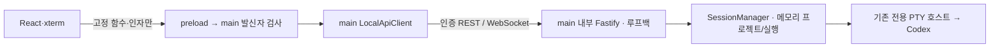

# T-004 로컬 연결·인증

**후속 T-005 완료:** 실제 앱의 프로젝트 조회는 SQLite 목록과 `activeProjectId`, `storage: 'sqlite'`를 반환한다. 저장 시작 실패는 `unavailable`로 구분한다. main의 고정 IPC로 확정 선택·이름 저장·백업/복원을 추가했고 프로젝트 상한은 100개·직렬화 목록 512 KiB다. [저장 계약](PROJECT_STORAGE.md)·WL-20261005-01을 따른다. 아래 메모리/16개·검사 수는 T-004 당시 이력이다.

기록 **WL-20261004-06**, 브랜치 `feat/t-004-local-api`. 선행 T-003의 `b246d27b18146c05da8c183553dfcdd71a66653f`에서 분기했다. 소스 커밋은 `252fbe23d211b96932fcd7ff9f7d13c3cc0dd5ce`다. T-004 완료이며 DB 저장·앱 재시작 복원은 T-005다.

## 실제 연결 구조



서버를 추가 프로세스로 분리하지 않고 main 안에서 관리한다. 창을 열기 전에 준비하고 `127.0.0.1`의 운영체제가 고른 포트만 사용한다. 일반 브라우저·LAN용 API가 아니다. 토큰은 시작마다 무작위 32바이트로 만들며 main 메모리에만 둔다. 화면·URL·로그·파일·AI 환경변수로 전달하지 않는다.

REST와 WS 업그레이드 모두 정확한 Host/Origin·인증 헤더·요청 UUID를 검사한다. 빌드 Origin은 명시적 `orbit://app`, 개발 Origin은 `http://127.0.0.1:5173`이다. `new URL(orbit주소).origin`의 `null`을 허용값으로 쓰지 않는다. 누락·타출처·중복 보안 헤더·전달 프록시 헤더·query를 거부한다. 응답은 캐시하지 않고 CORS 허용을 열지 않는다. 입력 스키마는 고정 코드이며 추가 필드·자동 타입 변환을 허용하지 않는다.

네이티브 폴더 선택으로 main이 등록한 프로젝트만 조회한다. 임의 경로 등록·명령·실행 파일·환경변수·CLI 대화 ID를 받는 API는 없다. 프로젝트는 최대 16개를 현재 실행의 메모리에만 둔다. 폴더 선택은 REST로 등록 결과를 재조회한다. 기존 UI의 폴더 취소 유지·복수 AI 선택·Codex 단일 실행을 보존했다.

## 확정한 최소 계약

| 접점 | 반환·입력 |
|---|---|
| GET `/v1/projects` | `{ projects: [{ id, name, path }], storage: 'memory' }` |
| GET `/v1/projects/:id` | 등록된 프로젝트 하나. 미등록 ID는 404 |
| GET `/v1/ai/availability` | 기존 Codex 설치·로그인 준비 조회 |
| GET `/v1/projects/:id/session` | 현재 상태와 처음부터 최대 64 KiB 출력 |
| GET `/v1/projects/:id/session/status` | 출력 본문 없는 현재 실행 상태 |
| POST `.../session/submit` | `prompt, expectedOutputId, expectedRunId` |
| POST `.../session/stop` | `expectedRunId` |
| POST `.../session/reset` | `expectedOutputId, expectedRunId` |
| POST `.../session/resize` | `cols` 20~512, `rows` 5~120 |
| WS `/v1/events` | `session.read` 요청 하나에 `session.snapshot` 사건 하나 |

REST 성공은 `schemaVersion: 1 / requestId / data`, 실패는 `schemaVersion / requestId / error`다. 오류에는 `code / message / retryable / requestId`를 둔다. 잘못된 형식 400, 인증 실패 401, 출처 실패 403, 미등록 404, 상태·중복 내용·오래된 요청 충돌 409, 본문 초과 413, 미지원 본문 415, 요청 한도 429, 종료 중 503을 구분한다. 내부 스택·인증값은 반환하지 않는다. POST는 `application/json`만 받는다.

POST에는 UUID `x-request-id`와 발급 시각(ms) `x-request-time`을 요구한다. 처음 보는 요청은 과거 60초~미래 5초 범위만 받는다. ID별로 경로·본문·발급 시각의 해시와 처리 중 Promise/결과를 먼저 등록한다. 같은 요청은 같은 결과, 같은 ID의 다른 내용은 409다. 최대 2,048개·120초 보관하며 유효한 항목을 먼저 지워 재실행시키지 않는다. 발급 시각을 그대로 가진 오래된 재전송은 보관 기간 이후에도 거부한다. 동일 ID를 새 발급 시각으로 새 요청처럼 만드는 악성 클라이언트의 의미적 중복까지 보장하는 계약은 아니다.

같은 대화에서 여러 실행이 이어져도 출력 세대는 유지될 수 있다. 따라서 submit/reset은 출력 세대와 실행 ID를 함께 비교하고 stop은 실행 ID를 비교한다. 화면이 오래된 상태에서 보낸 요청이 최신 실행을 바꾸지 않는다. 응답이 유실됐다는 이유로 변경 요청을 자동 재전송하지 않으며 입력을 유지하고 상태를 다시 확인하도록 안내한다.

## 출력·연결 복구·종료

WS 읽기 입력은 `type, requestId, projectId, outputId, after`다. 사건은 `schemaVersion, type, requestId, eventId, occurredAt, projectId, reset, gap, snapshot`을 반환한다. `outputId`가 다르거나 미래 커서를 요청하면 현재 세대의 처음부터 반환하고 `reset`을 표시한다. 보관 범위 이전이면 `gap`과 생략 안내를 제공한다. `nextSequence`는 전체 출력 끝이며 소비 완료 위치가 아니다.

화면은 `terminal.write`가 끝난 청크의 `sequence + 1`을 다음 읽기 커서로 사용한다. 한 번의 처리가 끝난 뒤 250ms 후 다시 읽으므로 서버→main→화면에 무한 push 큐를 만들지 않는다. 기존 출력 512 KiB 보관·조회 64 KiB·실행 8 MiB/10분 제한을 유지한다. 대시보드는 출력 없는 상태만 조회한다.

- HTTP 본문 32 KiB, 인증된 요청 100개/초, TCP 연결 32개, main HTTP 진행 요청 16개·응답 1 MiB·15초 한도.
- WS 입력 4 KiB, 연결 8개, 연결당 읽기 30개/초, 송신 대기 256 KiB, main 동시 읽기 8개·사건 512 KiB·3초 한도. 압축은 끈다. 서버는 5초마다 ping으로 연결 생존을 확인한다.
- 끊긴 연결은 다음 안전 조회에서 250ms부터 최대 4초 간격으로 재시도한다. 유효한 snapshot을 받기 전 실패가 8회 누적되거나 인증이 거부되면 자동 복구를 멈추고 ‘다시 연결’을 표시한다. 소켓 open만으로 복구 완료로 표시하지 않는다.
- 형식이 잘못돼도 유효한 요청 ID를 읽을 수 있으면 같은 ID로 오류를 반환한다. JSON 자체가 깨졌거나 ID를 알 수 없으면 WS 1008로 닫아 대기 중 요청을 즉시 해제한다. 크기 초과·과부하도 연결을 종료한다.
- 실패한 크기 변경은 성공으로 기억하지 않고 다음 정상 조회에서 최신 크기를 다시 적용한다. 실행 상태와 연결 상태를 분리하고 재연결 중 입력·표시 출력을 유지한다.
- 종료 요청 시 새 변경을 막고 기존 AI 정리를 기다린다. 정리 미확인으로 창을 유지하면 상태 조회는 남긴다. 종료 확정 뒤 client 요청/소켓과 서버를 닫는다. 인증을 거부한 WS도 정리되도록 WS 플러그인 등록을 인증 hook보다 먼저 한다.

## 검증과 한계

형식·타입·빌드, 기존 로직 19개, 실제 HTTP/WS 통합 7개 통과. 전체 Electron UI는 12개 통과·실제 계정 2개 의도적 skip. 별도 실제 Codex 검사 2개는 한글 응답/재개와 중단/앱 종료를 통과했다. 종료 후 관측 9개 PID의 프로세스·TCP는 0이었다. 강화한 연결/resize UI 검사 1개도 재통과했다. 마지막 오류 상관관계 수정 뒤 API 7개를 다시 통과했다. 개별 실행 결과를 한 번의 전체 실행으로 합치지 않는다.

```powershell
npm.cmd run lint
npm.cmd run build
npm.cmd test
npm.cmd run test:api
npm.cmd run test:ui
# 기존 로그인·실제 서비스 호출이 필요한 별도 검사
npm.cmd run test:ai-live
```

Astra/Max 요청 읽기 전용 검토를 반영했고 실제 내장 모델 메타데이터는 미확인이다. Gemini는 기존 잠금의 현재 잔존 조회 후 원본을 보존 이동하여 동일 Project deny 경로로 재시도했다. 23:08:35·23:11:46 KST의 Pro/High CLI 설정·응답·종료·관측 후손 0·시험 파일/설정 불변을 확인했다. 첫 검토의 두 조건부 지적은 실제 설정/검사와 대조해 미반영, 오류 ID 지적은 수정했고 재검토에서 추가 P1/P2 미발견 의견을 받았다. 모델 의견과 실행 검사 결과는 별개다.

다른 PC·패키징·장시간 부하·강제 main 충돌 복구·영구 저장·OS 파일 읽기 보호·LAN 전송은 검증 범위 밖이다. 제한된 관측과 토큰 인증을 OS 격리나 모든 자원 고갈 공격의 차단 보증으로 확대하지 않는다. Gemini CLI 설정 표시는 원격 엔진 신원 증명이 아니다. 런타임 증거와 전달문·잠금 원본은 `.runtime`에만 보존한다.

확인한 공식 자료(2026-10-04): [Fastify 입력 검사](https://fastify.dev/docs/latest/Reference/Validation-and-Serialization/), [Fastify WebSocket의 hook·메시지·종료 계약](https://github.com/fastify/fastify-websocket), [ws 연결 확인·상한](https://github.com/websockets/ws). 실제 고정 버전은 Fastify 5.12.5·websocket 11.3.3·ws 8.22.0·types/ws 8.18.2다.
