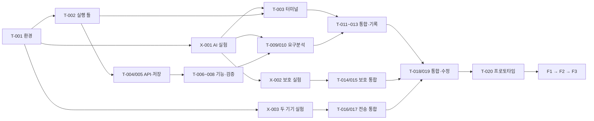

# 전체 개발 로드맵

2026-10-03 KST 기준 계획. 최종 목표와 포함 범위는 [PROJECT_OVERVIEW](PROJECT_OVERVIEW.md), 작업별 산출물·완료·검증은 [TASKS](TASKS.md)가 기준이다. 날짜가 지난 것과 실제 개발 지연은 다르다. 현재 실적은 [STATUS](STATUS.md)만으로 확인한다.

## A. 최종 프로젝트의 종료 조건

핵심 R-01~R-12와 권한 경계 R-14가 실제 사용자 흐름에서 동작하고, R-13·R-15·R-16의 저장·복구·품질·배포 기준을 만족해야 한다. R-17의 학교 시연·보고서·발표·제출과 R-18의 근거 기록까지 포함한다. 프로젝트 종료는 M3 또는 프로토타입 마감으로 대신하지 않는다.

1. **준비 단계:** 자료·실제 저장소·환경·기기·계정·시간·학교 기준 확인, 문서와 기록 체계 마련.
2. **프로토타입 단계:** M1~M8을 검토하여 작게 연결한 실제 흐름과 위험 기술 실증. 내부 마감 2026-10-19 23:59 KST.
3. **최종 완성 단계:** F1 안정화·운영 기능 보강 → F2 전체 수용 검증·보고/발표·사용자 확인·제출.
4. **유지보수 단계:** F3 지원 환경·알려진 한계·업데이트·복구·다음 작업 전달. 유지 기간과 추가 기능은 미정.

학교 중간 발표는 Q-01 답변 후 해당 시점의 실제 검증 범위로 별도 게이트(다음 단계로 넘어가기 위한 확인 시점)를 둔다. 날짜와 시연 범위를 현재 임의 확정하지 않는다.

## B. 프로토타입 범위

실제 동작: 프로젝트 선택·대화형 요구분석·기능 생성/편집·AI 1종 실행/중단·기능 검증/진행률·기록/복원. 보호는 지정 파일/폴더, 전송은 두 실제 기기의 파일 1개부터 한다. 완료 증거 없는 화면 시연은 별도 표기한다.

위험 실험 X-001~X-003의 결과를 먼저 얻는다. 보호 성공을 표시하려면 실제 OS 거부, 전송 성공을 표시하려면 실제 두 기기 해시 일치가 필요하다. 모의 화면·단일 컴퓨터의 로컬 연결은 이를 대체하지 않는다.

후속 후보인 다중 AI 동시 실행, 마인드맵 꾸미기, 자동 탐색, 폴더 전송, 이어받기를 넣어 핵심 통합 시간을 줄이지 않는다. 최종 핵심 요구는 유지한다.

## 원래 M1~M8 기준 일정 — 보존

출처: [Notion 프로토타입 일정](https://app.notion.com/p/3e96817a25718139b6b8ccf190650aa4), 최종 수정 2026-09-28 20:34:41.684 KST, 조회 2026-10-03. 모든 마감은 한국시간 23:59. 이 표는 기존 계획의 요약이며 재확정한 실행 약속이 아니다.

| 단계 | 원래 기간·마감 | 원래 목표·완료 기준 | 연결 작업·실적 |
|---|---|---|---|
| M1 | 09/28~09/30 · 09/30 | 첫 창·AI 터미널, 지정 폴더에서 대화 후 중단 | T-001~T-003,X-001 · 완료 증거 없음 |
| M2 | 10/01~10/03 · 10/03 | REST·WS·SQLite 복원·OS 보호 실험 결과/한계 기록 | T-004,T-005,X-002 · 완료 증거 없음 |
| M3 | 10/04~10/06 · 10/06 | 기능 트리·추가/수정/삭제·완료/재검증·진행률·복원 | T-006~T-008 · 완료 증거 없음 |
| M4 | 10/07~10/09 · 10/09 | 목표·질문/답변·기능 생성·미리보기/편집/적용·오류 보존 | T-009,T-010 · 완료 증거 없음 |
| M5 | 10/10~10/12 · 10/12 | 기능-세션 연결·상태·활동·변경 처리·완료 반영 | T-011~T-013 · 완료 증거 없음 |
| M6 | 10/13~10/15 · 10/15 | 보호 방식 앱 통합·직접/자식 거부·두 기기 전송·해시/실패 | T-014~T-017 · 완료 증거 없음 |
| M7 | 10/16~10/17 · 10/17 | 새 프로젝트 전체 흐름·주요 실패·오류 수정·데이터 보존 | T-018,T-019 · 완료 증거 없음 |
| M8 | 10/18~10/19 · 10/19 | 실행법·증거·한계·리허설·실행물/소스 백업 | T-020 · 완료 증거 없음 |

현재 10/03은 기존 M2 마지막 날이지만, 실제 M1 선행 동작이 확인되지 않은 상태에서 M2·M3를 완료한 것으로 이어가지 않는다. M1~M3를 오늘 하루에 끝낼 수 있다고 가정하지 않는다.

## C. 작업 순서와 변경 제안

| 제안 ID | 제안·이유 | 기준 계획에 대한 영향·결정 |
|---|---|---|
| P-01 | 실제 환경 T-001 → X-001과 T-002 → T-003을 확인하고 현재 위치 재설정 | 날짜 중심 진행을 증거 중심으로 전환. 달력 변경은 Q-01과 코드 확인 후 미정 |
| P-02 | X-003 전송 실험을 M6 직전이 아닌 초기 위험 확인(M2 묶음)으로 앞당김 | M2 공수 4~8h 추가, M6의 두 기기/인증 위험 조기 발견. 실제 통합 T-016/T-017은 여전히 M6 |
| P-03 | X-002를 8h 중간 판단·16h 한도로 관리 | OS 보호 실패를 빨리 드러냄. 실패 시 T-014 차단·대안/공수 재계획. R-09 삭제 아님 |
| P-04 | 마지막 통합·오류·시연 시간을 별도로 보존 | 원래 10/16 이후 안정화 원칙 유지. 앞 단계 초과로 조용히 잠식하지 않음 |
| P-05 | M8 이후 F1~F3를 추가로 계획 | 원래 프로토타입 일정의 누락을 전체 종료 계획으로 연결. 학교 최종 날짜는 Q-01 후 설정 |

구체적인 새 시작·종료 날짜는 **미정**이다. 순서를 앞당긴 실험과 유지할 내부 마감은 구분한다. 핵심 범위 축소·위험 수용·최종 시연 변경은 사용자 결정 기록을 남긴다.

### 선행 관계와 전체 일정에 영향을 주는 작업

도식은 주요 관계이고 세부 선행 조건은 TASKS가 기준이다. 1인 개발에서는 독립 화살표가 있어도 구현 시간이 자동 병렬로 줄어들지 않는다. 외부 리뷰는 읽기 전용으로 나눌 수 있지만 취합·수정 시간은 남는다.

- AI 경로: T-001 → X-001/T-002 → T-003, T-004/T-005 → 기능/요구분석 → T-011~T-013 → T-018~T-020.
- 보호 경로: X-001 → X-002의 실제 성공 → T-014 → T-015 → T-018. 실행 권한과 로그인 호환 실패가 전체 시연을 막을 수 있다.
- 전송 경로: 두 기기/LAN 확보 → X-003 → T-016 → T-017 → T-018.
- 최종 경로: 학교 기준 확인 + F1 결과 → T-106 → T-107/T-108 → 사용자 확인 T-109. 하나라도 막히면 제출 준비에 영향을 준다.

기간 불확실성이 크므로 최장 경로의 정확한 종료일은 계산하지 않는다. 위 경로와 한 사람의 총 작업량을 함께 보고 재계획한다.

## 공수·가용 시간 비교

[TASKS](TASKS.md)의 합계를 사용한다. 이미 구현된 부분이 실제 검증되면 해당 남은 공수만 줄인다. AI 출력 속도로 사람의 통합·검증 시간을 0으로 만들지 않는다. 학습·환경 설치가 예상보다 길어지면 즉시 재추정한다.

| 묶음 | 예상 순작업 시간 |
|---|---|
| M1 | 15~27h |
| M2 + 앞당긴 X-003 | 20~38h |
| M3 | 10~17h |
| M4 | 8~14h |
| M5 | 10~17h |
| M6 | 20~38h |
| M7 | 14~26h |
| M8 | 5~8h |
| 프로토타입 작업 합계 | **102~185h** |
| 별도 위험 여유 제안 | **12~22h** |
| 프로토타입 계획 용량 | **114~207h** |

M7·M8의 19~34h와 추가 여유 12~22h를 합한 31~56h(전체 약 27%)가 통합·수정·시연·불확실성 대응 시간이다. 개별 작업에 포함된 기능 검증은 별도이며 중복 가산하지 않았다. 실제 가용 시간의 약 30%를 이런 마무리와 위험 대응에 확보하는 방향을 권장한다.

M1~M3만도 45~82h다. 일일 동시 완수 전제는 성립하지 않는다. X 작업은 한도 내 성공이 보장되는 견적이 아니다. 실패하면 남은 설계·일정을 다시 잡는다.

10/03~10/19는 오늘 포함 17개 날짜다. 오늘도 같은 시간을 확보한다는 **단순 비교 예시**는 다음과 같다.

| 하루 순개발 시간 예시 | 17일 용량 | 114~207h와 비교 |
|---|---|---|
| 2h | 34h | 80~173h 부족 |
| 4h | 68h | 46~139h 부족 |
| 6h | 102h | 12~105h 부족 |
| 8h | 136h | 낮은 추정은 가능, 높은 추정은 71h 부족 |

실제 식: **오늘 남은 개발 가능 시간 + 10/04~10/19 각 날짜에 확보한 시간의 합**. 하루 8h를 사용자의 현실적인 가용 시간으로 가정하지 않는다. 현재 일부 가용 시간만 확인됐고 평일별 시간은 미정이다. 지금부터 전부 시작한다면 전체 프로토타입은 높은 일정 위험이다.

### 사용자 답변을 반영한 실제 용량

U2: **금요일·주말 하루 6~7h**, 나머지 평일은 일정에 따라 변동. AI 활용 전제. 오늘(10/03) 실제 남은 시간은 아직 확인되지 않아 6~7h 전체를 다시 배정하지 않는다.

10/04, 10/09~10/11, 10/16~10/18의 7일은 합계 **42~49h**다. 나머지 9개 평일과 오늘의 남은 시간이 추가 용량이다.

| 나머지 9평일의 하루 예시 | 오늘 제외 총 용량 | 의미 |
|---|---|---|
| 0h | 42~49h | 확인된 금/주말만 반영 |
| 1h | 51~58h | X 실험과 첫 흐름 우선 필요 |
| 2h | 60~67h | 전체 114~207h에 크게 부족 |
| 4h | 78~85h | 오늘 시간이 추가되어도 낮은 추정 114h보다 작음 |

최소 추정 114h를 맞추려 해도 알려진 49h 외에 **오늘+9평일에서 65h**가 더 필요하다. 이 시간을 가능하다고 가정하지 않는다. 권장 실행은 T-001 → X-001/T-002/T-003의 첫 실제 흐름을 확인하고 X-002/X-003의 위험을 조기에 판단하는 것이다. 금·주말의 긴 구간에 기기/보안 실험을 배치하고, 짧은 평일 구간에는 독립된 작은 구현·검토·기록을 배치한다. 특정 날짜의 착수를 확정하지 않는다.

10/16~10/18 세 긴 작업일 18~21h는 통합·오류 수정·시연에 먼저 예약하는 **제안**이다. 10/19 가용 시간은 미정이므로 마무리 전체를 마지막 월요일에 의존하지 않는다. 실제 캘린더는 Q-01 답변을 보완한 뒤 정한다.

### 마감 위험에 대한 선택지

1. 권장: 확장 후보를 넣지 않고 작은 실제 흐름·위험 실험을 우선한다. 10/16~10/19 통합/시연 시간은 보존한다. 위험이 드러나면 그날 공수와 범위를 다시 비교한다.
2. 여유 시간이 부족하면 기능별 실제 동작/화면만/실험 실패/미실행을 구분한 **부분 프로토타입**을 제안한다. 이를 기존 전체 프로토타입 목표 달성으로 표시하지 않는다. R-09·R-11의 최종 요구는 유지한다.
3. 전체 프로토타입을 내부 마감까지 요구한다면 실제 투입 시간을 늘릴 수 있는지 확인하거나 내부 마감 변경을 제안한다. 과도한 하루 시간을 약속으로 잡지 않는다.
4. 어떤 핵심 시연 항목을 뒤로 미루는지는 사용자 결정이다. 선택 전까지 원래 요구·마감은 보존하고 수정안은 제안으로 남긴다.

## 프로토타입 이후

| 단계 | 작업·산출물·통과 조건 | 공수·시점 |
|---|---|---|
| F1 최종 기능·운영 보강 | T-101~T-105. 설치/업데이트/제거, 백업/DB 복구, 보호·전송 보안, 성능·장시간·사용성 | 29~56h 초기 범위. 프로토타입 결과 후 다시 분해·추정 |
| F2 최종 검증·제출 준비 | T-106~T-109. 모든 R/V 근거, 오류 수정, 보고서·발표·리허설, 사용자 최종 확인·제출 사본 | 23~46h. 학교 일정·평가 기준에 맞춰 확정 |
| F3 유지보수·인수인계 | T-110. 지원/미지원, 업데이트·장애·복구, 다음 작업 기록 | 2~4h 초기 안내. 이후 운영 시간은 미정 |
| 최종 추가 합계 | 기본 54~106h + 위험 여유 제안 8~16h | **62~122h**, 확정 일정 아님 |

전체 남은 계획 용량은 프로토타입 114~207h + 최종 추가 62~122h = **176~329h**의 거친 범위다. 학교 추가 요구, 큰 OS 대안 변경, 여러 AI 지원은 포함되지 않아 범위를 다시 계산해야 한다. 주당 확인된 금/주말 용량은 18~21h이며 나머지 4평일의 시간이 더해진다. 주당 10/20/30h일 때 약 18~33/9~17/6~11주라는 단순 용량 비교만 가능하며 최종 날짜 약속이 아니다.

## D. 바로 실행할 작업

현재 날짜는 2026-10-03 KST. 이번 요청에서는 D-001/D-002 문서 작업까지만 한다. 후속 개발 첫 작업은 **T-001 환경·계정과 지원 버전 기록(1~2h 제안)**이다.

- 시작 조건: 정확한 대상 저장소·선행 문서 기준 커밋·단일 수정 담당 확인, 실제 오늘 가용 시간과 후속 개발 요청 범위 확인. 다른 작업의 미커밋 변경 보존.
- 범위: 프로젝트 파일/실행 명령의 존재, Windows/CPU·Node/Git·Codex CLI, 로그인 가능 여부·두 기기·안전 실험 환경을 비밀 없이 확인한다. 없는 설치·명령은 필요 항목으로 남긴다.
- 완료 조건: 환경표·지원/미확인/실패 구분·다음 X-001의 시작/막힘 조건·실행 결과를 작업 기록에 남긴다. 앱 기능 완료를 주장하지 않는다.
- 검증: 경로·원격·브랜치·상태, 버전 조회, 도구가 제공하는 로그인 상태 표시. 로그인 비밀·인증 링크는 기록하지 않는다. CLI가 없으면 ‘미설치/현재 세션에서 미발견’으로 종료하고 별도 설치 범위를 정한다.
- 다음: 충분한 시간과 환경이 있으면 X-001(4~8h)을 별도 작업으로 시작한다. T-001을 끝낸 날 M1~M3 전체를 연속 완료한다고 전제하지 않는다.

실제 코드 상태가 확인되면 이 순서를 이미 검증된 선행 작업 다음으로 조정하고, 이유를 STATUS와 날짜별 기록에 남긴다.
